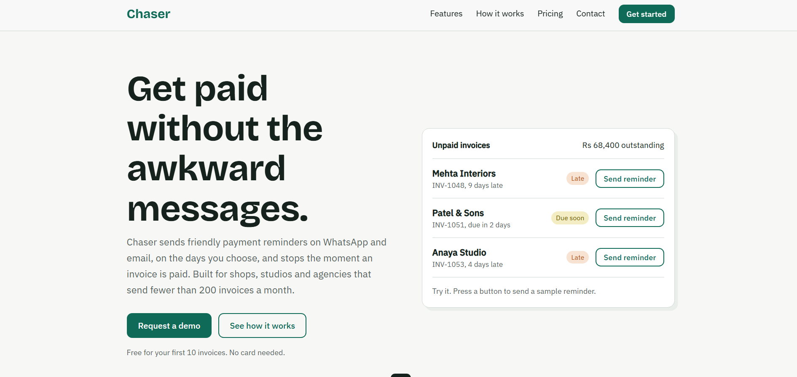
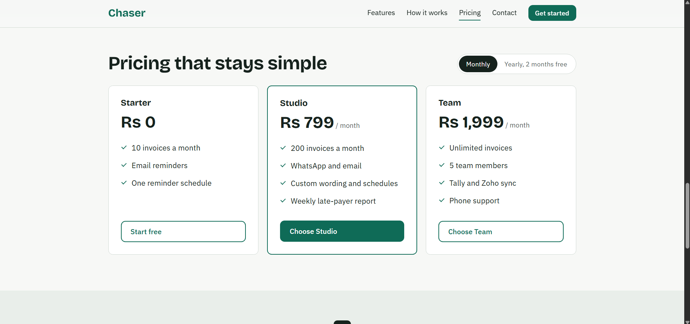
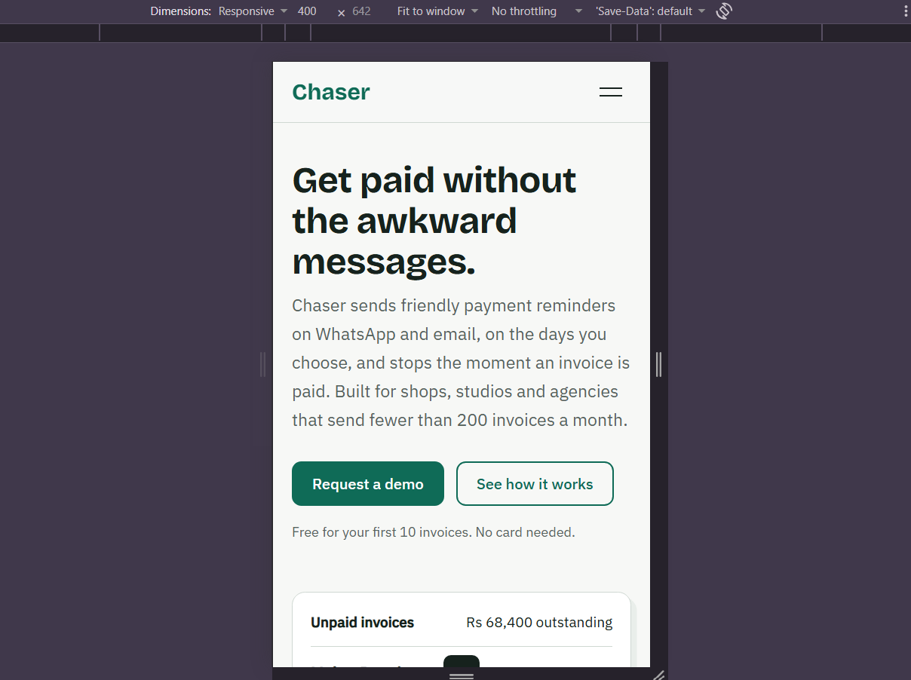
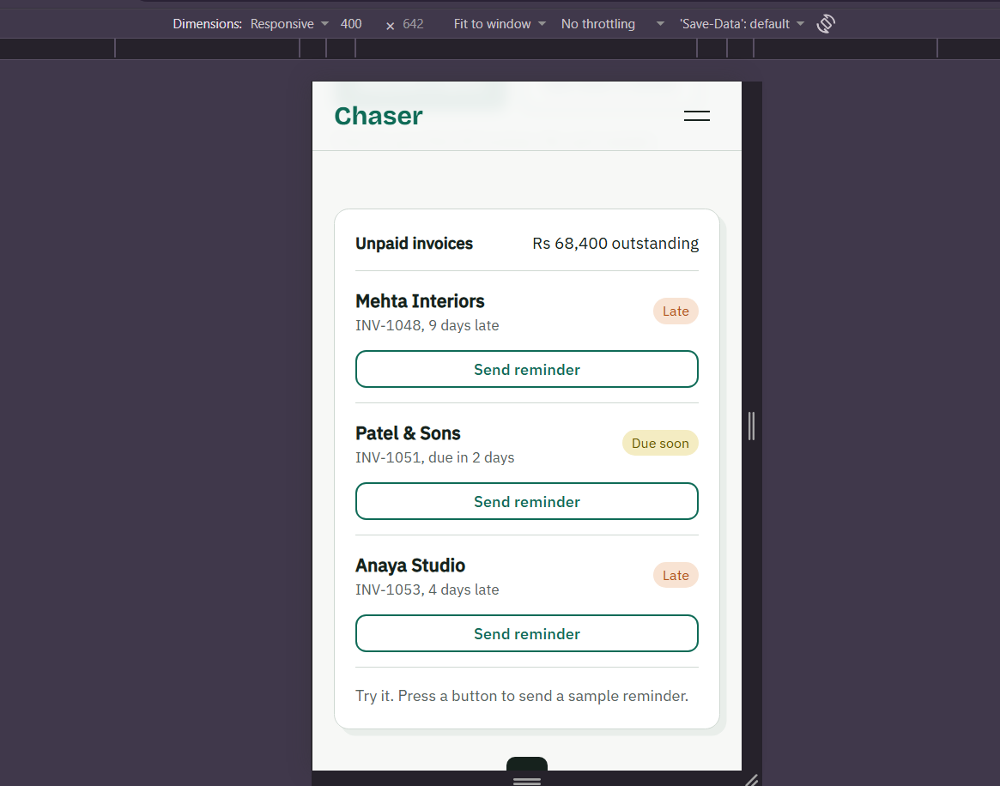
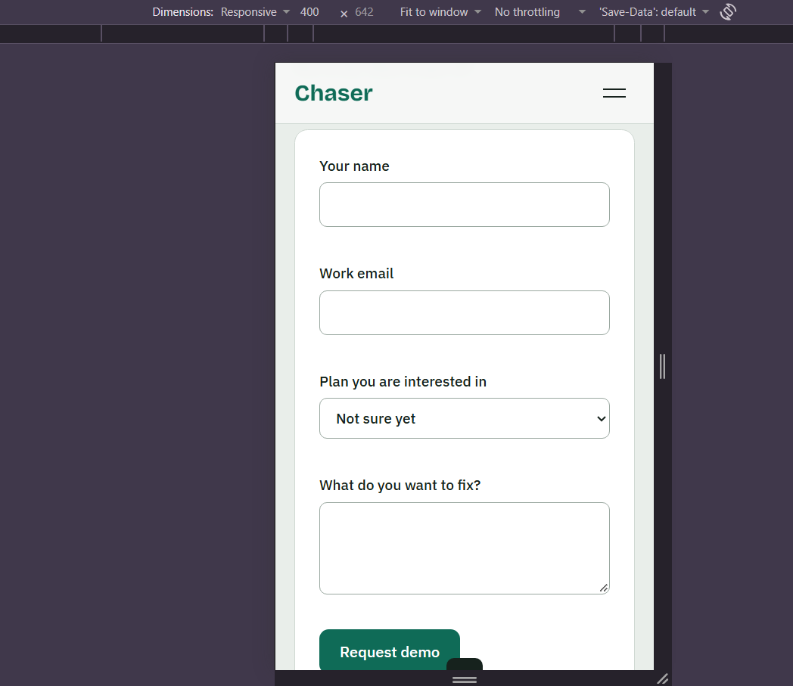

# Chaser: SaaS Landing Page

A responsive landing page for **Chaser**, a fictional SaaS product that sends polite payment reminders over WhatsApp and email for unpaid invoices. It was built as the front-end internship assignment for Sankar Group.

The page runs without a backend. Every interaction (navigation, the invoice demo, the pricing toggle and the contact form) works in the browser.

---

## Table of contents

1. [Screenshots](#screenshots)
2. [Overview](#overview)
3. [Features](#features)
4. [Page sections](#page-sections)
5. [Tech stack](#tech-stack)
6. [Project structure](#project-structure)
7. [Getting started](#getting-started)
8. [How the interactions work](#how-the-interactions-work)
9. [Responsive design](#responsive-design)
10. [Accessibility](#accessibility)
11. [Design decisions](#design-decisions)
12. [Challenges and solutions](#challenges-and-solutions)
13. [Customising the project](#customising-the-project)
14. [Known limitations](#known-limitations)
15. [Author](#author)

---

## Screenshots

### Desktop





### Mobile

| Hero | Menu open | Form validation |
|------|-----------|-----------------|
|  |  |  |

---

## Overview

Small businesses often lose time and goodwill chasing late payments by hand. Chaser is an invented product that automates those follow-ups: it sends reminders on a schedule the owner chooses and stops as soon as the invoice is paid.

The landing page explains the product, shows it working in the first screen, and guides visitors to request a demo.

**Goals of the page**
- Explain what the product does in one screen.
- Let visitors try a small version of the product before signing up.
- Lead visitors toward the demo request form.
- Work well on phones and desktops.

---

## Features

- Sticky navigation bar with smooth scrolling to each section
- Highlight of the current section in the navigation while scrolling
- Mobile menu that opens from a burger button and closes on link click or the Escape key
- Interactive hero demo: send sample reminders and watch the outstanding total change
- Feature section with blocks of different sizes and inline SVG icons
- Step-by-step "How it works" section
- Three pricing plans with a monthly and yearly toggle
- Plan buttons that pre-select the chosen plan in the contact form
- Contact form with field validation, inline error messages and a success message
- Toast notification for demo actions
- Footer with automatically updated copyright year

---

## Page sections

| Section | Purpose |
|---------|---------|
| Navigation | Product name, links to each section, and a Get started button |
| Hero | Headline, short description, call-to-action buttons and the interactive invoice list |
| Features | Four key features: multi-channel reminders, custom schedule, auto-stop on payment, and late-payer reports |
| How it works | Three steps: bring in invoices, pick a reminder style, let it run |
| Pricing | Starter, Studio and Team plans with a billing period toggle |
| Contact | Demo request form with contact details |
| Footer | Product note and copyright |

---

## Tech stack

| Area | Technology |
|------|------------|
| Markup | HTML5 (semantic elements) |
| Styling | CSS3: custom properties, Grid, Flexbox, media queries |
| Behaviour | Vanilla JavaScript (ES5 syntax inside an IIFE) |
| Fonts | Bricolage Grotesque and IBM Plex Sans (Google Fonts) |
| Icons | Inline SVG |

No frameworks, build tools or backend are used. The only external request is the Google Fonts stylesheet, and the page falls back to system fonts if it is unavailable.

---

## Project structure

```
.
├── index.html              # Page markup
├── README.md               # Project documentation
├── screenshots/            # Images used in this README
└── assets/
    ├── css/
    │   └── style.css       # All styles, with colour tokens in :root
    └── js/
        └── main.js         # Menu, demo, pricing toggle, form validation
```

---

## Getting started

### Requirements
- A modern browser (Chrome, Edge, Firefox or Safari)
- Optional: Python 3, if you want to serve the folder locally

### Run the project

**Option 1: open the file**

Double-click `index.html`.

**Option 2: run a local server**

```bash
python -m http.server 8000
```

Then open `http://localhost:8000` in your browser. On Windows, use `py -m http.server 8000` if `python` is not recognised.

---

## How the interactions work

### Navigation and smooth scrolling
Links use in-page anchors such as `#features`. `scroll-behavior: smooth` and `scroll-padding-top: 76px` on `html` make the page glide to the section and keep its heading clear of the sticky header.

### Active section highlight
An `IntersectionObserver` watches the four main sections. When one crosses the middle of the viewport, the matching navigation link gets an `act` class.

### Mobile menu
The burger button toggles the `open` class on the menu and updates `aria-expanded` and `aria-label`. The menu closes when a link is clicked or Escape is pressed.

### Hero invoice demo
Each "Send reminder" button marks its row as sent, changes the status tag, disables the button, shows a toast message and recalculates the outstanding total using Indian number formatting. The note under the list updates once every reminder has been sent. Nothing is actually sent.

### Pricing toggle
Each price stores its monthly and yearly value in `data-m` and `data-y` attributes. The toggle swaps the text and changes the label between "month" and "year". The active button is shown with `aria-pressed`.

### Plan selection
Plan buttons carry a `data-plan` attribute. Clicking one pre-selects that plan in the form and scrolls to the contact section.

### Form validation

| Field | Rule |
|-------|------|
| Name | At least 2 characters |
| Work email | Required, must match a basic email pattern |
| Plan | Optional |
| Message | At least 10 characters |

Fields are checked when the user leaves them. Once a field shows an error, it is rechecked on every keystroke so the message clears as soon as the problem is fixed. On submit, all fields are checked, focus moves to the first invalid field, and a success message appears when everything passes. No data leaves the browser.

---

## Responsive design

The layout was designed for desktop and mobile, with these breakpoints:

| Breakpoint | Changes |
|------------|---------|
| Above 860px | Two-column hero, asymmetric feature grid, three-column pricing, horizontal navigation |
| 860px and below | Single-column sections, stacked pricing cards, burger menu, simplified feature grid |
| 480px and below | Invoice rows stack the button under the invoice details, and the wide feature block becomes a simple block |

Text sizes for the main headings use `clamp()` so they scale smoothly between screen sizes. The page was designed to work from 360px wide upward.

---

## Accessibility

- Skip link to jump to the main content
- Visible keyboard focus on all interactive elements
- `aria-expanded`, `aria-controls` and `aria-label` on the mobile menu button
- `aria-pressed` on the billing toggle
- `aria-invalid` and inline error text on invalid form fields
- `role="status"` on the success message and toast so screen readers announce them
- Decorative SVG icons are hidden from assistive technology
- Smooth scrolling and transitions are switched off for users who prefer reduced motion

---

## Design decisions

- **Product idea:** Late invoice payment is a concrete problem, so the page can talk about it directly instead of using vague software language.
- **Live demo in the hero:** Visitors see the product working immediately instead of looking at a stock illustration.
- **Colour:** A deep green with soft grey backgrounds suits a product about money and paperwork. Orange and yellow are reserved for late and due-soon invoice tags.
- **Typography:** Bricolage Grotesque gives headings some character, and IBM Plex Sans keeps body text readable.
- **Uneven feature blocks:** The features are not equally important, so the layout reflects that.
- **Numbers only where needed:** Numbered markers appear only in "How it works", because the order of those steps matters.
- **Limited motion:** Motion is used only in response to a user action, such as the toast, the menu icon and the demo buttons.

---

## Challenges and solutions

| Challenge | Solution |
|-----------|----------|
| Sticky header covering section headings after a link click | Added `scroll-padding-top` on `html` |
| Keeping pricing and contact connected | Plan buttons pre-select the plan in the form |
| Form errors feeling annoying while typing | Fields are validated on blur first, and only rechecked live after an error appears |
| Complex feature grid on small screens | Each block spans the full width below 860px |
| Showing the product without a backend | A small in-browser demo updates the UI and totals |

---

## Customising the project

- **Colours:** Edit the CSS variables at the top of `assets/css/style.css`, in the `:root` block.
- **Product name and copy:** Update the text in `index.html`.
- **Pricing:** Change the `data-m` and `data-y` values on each price in the pricing section.
- **Demo invoices:** Edit the `<li>` items in the `#inv` list. The `data-amt` attribute controls the outstanding total.
- **Validation rules:** Edit the `check()` function in `assets/js/main.js`.

---

## Known limitations

- The contact form does not send data anywhere. It shows a success message only.
- The invoice demo is a simulation and resets when the page is reloaded.
- Contact details and company information are sample content.
- Fonts load from Google Fonts, so the first visit needs an internet connection to show the intended typefaces.

---

## Author

**Sherwin Dmonte**
Front-end internship assignment for Sankar Group

- GitHub: [(SherwinDmonte)](https://github.com/SherwinDmonte)